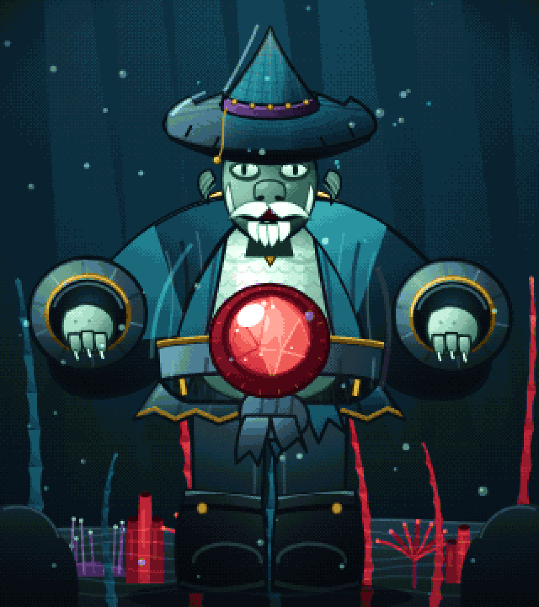
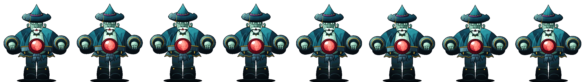

# حارس الشعاب العميقة · Deep Reef Warden

استوديو أصول بكسل كامل مكتوب بالكود: الشخصية، العالم، الحركة، اللوحة اللونية، والتصدير.
لا توجد أي صورة جاهزة — كل بكسل يُولَّد في كل إطار.

A complete pixel-art asset studio written entirely in code: character, world, animation,
palette and export pipeline. No pre-made art — every pixel is generated per frame.



---

## ما الذي يوجد هنا؟ · What's inside

| | |
|---|---|
| **الشخصية** | `src/art/guardian.js` — بنية مبنية على قياسات الشكل المرجعي (قبعة 108px، رأس 72px، كتفان، جيبوب مرجاني r24، أكمام r33، حذاء عند 350). |
| **العالم** | `src/engine/scene.js` — عمود ماء، أشعة ضوء، ثلاث طبقات عمق، طحالب تهتز، مرجان، فقاعات، ذرات، فينييت. |
| **اللوحة** | `src/art/palette.js` — 66 لونًا في 8 رامبات (ثوب/صدر/جوهرة/ذهب/بنفسج/جلد/حذاء/معدن). |
| **خط البكسل** | `src/engine/pixel.js` — تلوين ناعم ثم تكميم إلى اللوحة مع ترتيب Bayer (8×8) لتوليد ملمس بكسل أصيل. |
| **الهيكل** | `src/engine/rig.js` — 26 قناة تحويل + 8 حركات كدوال رياضية `t → rig` (قابلة للتدقيق والتوليد المحدد). |
| **العرض** | `src/engine/renderer.js` — تصيير عند 320×360 ثم تكبير بدون تنعيم (`image-rendering: pixelated`). |
| **التصدير** | شرائح PNG شفافة، إطار PNG بدقة 4×، وGIF متحرك عبر مُرمِّز GIF89a مكتوب من الصفر (`src/engine/gif.js`). |
| **الواجهة** | `index.html` + `src/app/main.js` — واجهة عربية RTL، مكتبة حركات، خط زمني، تحكم بالسرعة/التكبير/الحدّة. |

## التشغيل · Run

```bash
npm install          # للتطوير فقط (أدوات المعاينة) — الواجهة نفسها تعمل بالمتصفح دون أي حزم
npm run dev          # http://localhost:5173
```

المشروع **بدون أي مكتبات في المتصفح** (لا React ولا Canvas libs) — وحدات ES أصلية.

## الحركات الثمانية · The eight animations

| مفتاح | الاسم | المدة | الفكرة |
|---|---|---|---|
| `idle` | وقوف | 4.2s | تنفّس هادئ + نبض الجوهرة + رمشة |
| `breathe` | تنفّس عميق | 3.4s | تمدد الصدر وتوقيت ثقيل |
| `talk` | كلام | 2.6s | حركة فم متعددة الترددات + إيماءة رأس |
| `bow` | انحناء | 3.6s | تحية ثقيلة ثم رفع |
| `roar` | زئير | 3.2s | شهيق، فتح الفك 17px، ارتجاف القبعة والجسم |
| `cast` | استدعاء | 4.4s | شحن الجوهرة (تكبير + توهّج) ثم إطلاق |
| `walk` | مشي | 1.9s | خطوة متمايلة مع تمايل الثوب |
| `float` | طَفْو | 5.0s | ارتفاع 18px عن الأرض مع رفرفة |

كل حركة دالة مستمرة (`sin`/`smoothstep`) — لا يوجد قطع مفاجئ، والتبديل بينها يعمل بتلاشٍ متقاطع 0.45s.

## أدوات التطوير · Dev tools

```bash
node tools/preview.mjs out.png 3 idle     # إطار واحد مكبّر
node tools/preview.mjs out.png 1 roar 8 4 # شريحة إطارات لحركة
node tools/sheet.mjs 8 1                  # شرائح لكل الحركات → docs/sheets
node tools/gif-test.mjs out.gif cast 16    # GIF متحرك
node tools/smoke.mjs                      # اختبار الواجهة عبر DOM وهمي
node tools/perf.mjs                       # قياس زمن الإطار (المتصفح ~2-4ms/إطار)
```

`@napi-rs/canvas` مستخدم فقط في هذه الأدوات (Node)، وليس في التطبيق.

## مواصفات الأصل · Asset spec

- اللوحة: 66 لونًا ثابتًا، 8 رامبات، إضاءة قمرية من أعلى اليسار + انعكاس دافئ من الجوهرة.
- مساحة الرسم: 320×360 بكسل منطقي (الشخصية ~356px طولًا).
- الظل: مستوي (base + ظل صلب + ضوء صلب) مع خطوط نسيج قليلة — أسلوب يبقى مقروءًا بعد التكميم.
- الخطوط الخارجية: 2–3px حبر موحّد `#04101a` للفصل عن الخلفية.
- الحركة: 60fps تحليلي، مستقل عن معدل الإطارات، والتصدير محدَّد النتيجة (deterministic).


